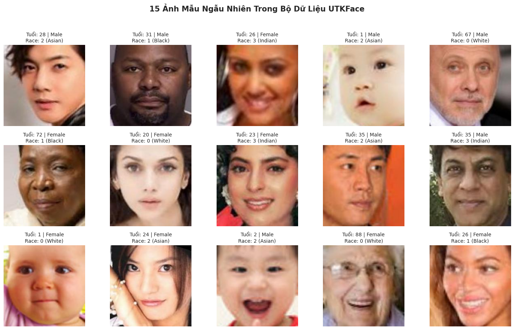
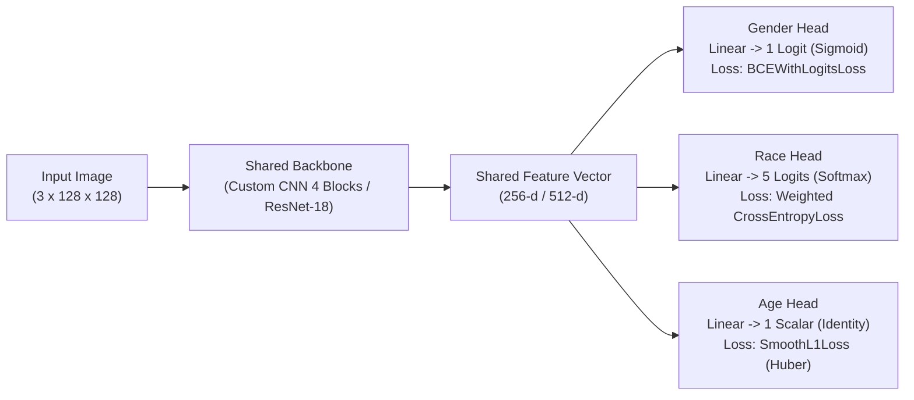
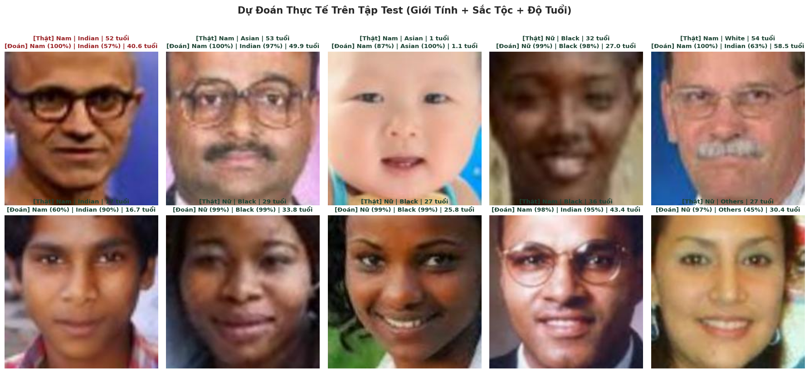
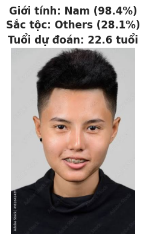

# UTKFace Facial Analytics with Convolutional Neural Networks (PyTorch)

[](https://www.python.org/)
[](https://pytorch.org/)
[-F9AB00?logo=googlecolab&logoColor=white)](https://colab.research.google.com/)
[-20BEFF?logo=kaggle&logoColor=white)](https://www.kaggle.com/datasets/jangedoo/utkface-new)

Dự án nghiên cứu và triển khai **Mạng Nơ-ron Tích chập (Convolutional Neural Network — CNN)** bằng **PyTorch** nhằm giải quyết đồng thời hai nhóm bài toán **Phân loại (Classification)** và **Hồi quy (Regression)** trên bộ dữ liệu ảnh khuôn mặt **UTKFace** (`23,705` ảnh hợp lệ):

1. **Binary Classification (`BinaryGenderCNN`)**: Phân loại nhị phân Giới tính (`Male` vs. `Female`).
2. **Multi-class Classification (`MultiClassRaceCNN`)**: Phân loại đa lớp 5 nhóm Sắc tộc (`White`, `Black`, `Asian`, `Indian`, `Others`) với cơ chế **Balanced Class Weights** xử lý mất cân bằng dữ liệu.
3. **Continuous Regression (`AgeRegressionCNN`)**: Hồi quy ước lượng Độ tuổi liên tục (`1 – 116` tuổi) sử dụng **Huber Loss (`SmoothL1Loss`)** kháng nhiễu ngoại lai (Outliers).
4. **Multi-Task Transfer Learning (`MultiTaskFaceResNet`)**: Kiến trúc hợp nhất dùng chung Backbone **`ResNet-18`** (pretrained trên ImageNet) với 3 nhánh đầu ra dự đoán đồng thời cả **Giới tính + Sắc tộc + Độ tuổi** trong một lượt suy luận duy nhất.

---

## Mục lục

- [1. Cấu trúc Repository](#1-cấu-trúc-repository)
- [2. Giai đoạn 1: Phân tích Khám phá Dữ liệu (EDA — `UTKFace_1.ipynb`)](#2-giai-đoạn-1-phân-tích-khám-phá-dữ-liệu-eda--utkface_1ipynb)
  - [2.1. Kiểm tra tính toàn vẹn & Làm sạch dữ liệu (Data Cleaning)](#21-kiểm-tra-tính-toàn-vẹn--làm-sạch-dữ-liệu-data-cleaning)
  - [2.2. Phân tích biến mục tiêu Regression (`age`) & Phát hiện Outliers](#22-phân-tích-biến-mục-tiêu-regression-age--phát-hiện-outliers)
  - [2.3. Phân tích biến mục tiêu Classification (`gender` & `race`) & Tính Class Weights](#23-phân-tích-biến-mục-tiêu-classification-gender--race--tính-class-weights)
  - [2.4. Phân tích đa biến (Multivariate Analysis: `Age` theo `Gender` & `Race`)](#24-phân-tích-đa-biến-multivariate-analysis-age-theo-gender--race)
  - [2.5. Khảo sát đặc trưng ảnh & Thống kê Pixel RGB](#25-khảo-sát-đặc-trưng-ảnh--thống-kê-pixel-rgb)
- [3. Cơ sở Lý thuyết: Từ Kết quả EDA đến Thiết kế Kiến trúc CNN](#3-cơ-sở-lý-thuyết-từ-kết-quả-eda-đến-thiết-kế-kiến-trúc-cnn)
- [4. Giai đoạn 2: Kết quả Huấn luyện & Đánh giá Thực nghiệm (`UTKFace_2.ipynb`)](#4-giai-đoạn-2-kết-quả-huấn-luyện--đánh-giá-thực-nghiệm-utkface_2ipynb)
  - [4.1. Bảng Tổng hợp So sánh Hiệu năng trên Tập Test (`3,556` ảnh)](#41-bảng-tổng-hợp-so-sánh-hiệu-năng-trên-tập-test-3556-ảnh)
  - [4.2. Đánh giá Mô hình 1: `BinaryGenderCNN`](#42-đánh-giá-mô-hình-1-binarygendercnn)
  - [4.3. Đánh giá Mô hình 2: `MultiClassRaceCNN`](#43-đánh-giá-mô-hình-2-multiclassracecnn)
  - [4.4. Đánh giá Mô hình 3: `AgeRegressionCNN`](#44-đánh-giá-mô-hình-3-ageregressioncnn)
  - [4.5. Đánh giá Mô hình 4: `MultiTaskFaceResNet` (`ResNet-18`)](#45-đánh-giá-mô-hình-4-multitaskfaceresnet-resnet-18)
  - [4.6. Trực quan hóa Dự đoán trên Tập Test & Ảnh Thực tế](#46-trực-quan-hóa-dự-đoán-trên-tập-test--ảnh-thực-tế)
- [5. Hướng dẫn Cài đặt & Chạy Thực nghiệm trên Google Colab](#5-hướng-dẫn-cài-đặt--chạy-thực-nghiệm-trên-google-colab)

---

## 1. Cấu trúc Repository

```text
utkface/
├── UTKFace_1.ipynb          # Giai đoạn 1: Notebook Phân tích Khám phá Dữ liệu (EDA) & Suy luận Thuật toán
├── UTKFace_2.ipynb          # Giai đoạn 2: Notebook Xây dựng, Huấn luyện & Đánh giá 4 Mô hình CNN (PyTorch)
├── REPORT.md                # Báo cáo kỹ thuật chuyên sâu (Phân tích toán học, kiến trúc & đánh giá lỗi)
├── README.md                # Tài liệu tổng quan dự án và kết quả thực nghiệm
└── assets/                  # Thư mục chứa biểu đồ EDA và kết quả đánh giá trích xuất từ thực nghiệm
    ├── 01_eda_age_distribution.png
    ├── 02_eda_gender_race_distribution.png
    ├── 03_eda_multivariate_age_gender_race.png
    ├── 04_eda_sample_faces.png
    ├── 05_cnn_binary_gender_results.png
    ├── 06_cnn_multiclass_race_results.png
    ├── 07_cnn_age_regression_results.png
    ├── 08_multitask_resnet18_test_predictions.png
    └── 09_custom_image_inference.png
```

---

## 2. Giai đoạn 1: Phân tích Khám phá Dữ liệu (EDA — `UTKFace_1.ipynb`)

Thay vì chọn ngẫu nhiên kiến trúc mạng, hàm kích hoạt (Activation Function) hay hàm mất mát (Loss Function), dự án thực hiện khảo sát định lượng toàn bộ tập dữ liệu **UTKFace** (`jangedoo/utkface-new`) để làm căn cứ thiết kế mô hình.

### 2.1. Kiểm tra tính toàn vẹn & Làm sạch dữ liệu (Data Cleaning)

- **Phát hiện trùng lặp thư mục trong gói dữ liệu gốc**: Gói `jangedoo/utkface-new` trên Kaggle chứa 3 thư mục con có ảnh trùng lặp (`UTKFace/` với `23,708` ảnh, `utkface_aligned_cropped/UTKFace/` với `23,708` ảnh, và `crop_part1/` với `9,780` ảnh). Nếu quét đệ quy toàn bộ mà không lọc, dữ liệu sẽ bị nhân bản gấp đôi gây hiện tượng **rò rỉ dữ liệu (Data Leakage)** giữa tập Train và tập Test. Dự án chỉ trích xuất duy nhất thư mục chuẩn `UTKFace/`.
- **Quy tắc gán nhãn từ tên file**:
  $$\text{[age]}\_\text{[gender]}\_\text{[race]}\_\text{[date\&time]}.\text{jpg}$$
  - `age`: Số nguyên thuộc đoạn $[1, 116]$.
  - `gender`: `0` = **Male (Nam)**, `1` = **Female (Nữ)**.
  - `race`: `0` = **White (Da trắng)**, `1` = **Black (Da đen)**, `2` = **Asian (Châu Á)**, `3` = **Indian (Ấn Độ)**, `4` = **Others (Khác)**.
- **Kết quả lọc dữ liệu lỗi**:
  - Tổng số file ảnh duy nhất tìm thấy: **`23,708` ảnh**.
  - Phát hiện và loại bỏ **`3` file bị khuyết nhãn `race`** (`< 4` trường thông tin):
    1. `61_1_20170109142408075.jpg.chip.jpg`
    2. `61_1_20170109150557335.jpg.chip.jpg`
    3. `39_1_20170116174525125.jpg.chip.jpg`
  - **Tổng số mẫu hợp lệ đưa vào huấn luyện**: **`23,705` ảnh**.

---

### 2.2. Phân tích biến mục tiêu Regression (`age`) & Phát hiện Outliers

| Chỉ số thống kê | Giá trị thực nghiệm | Ý nghĩa đối với bài toán Regression |
| :--- | :---: | :--- |
| **Số lượng mẫu ($N$)** | `23,705` | Quy mô đủ lớn để huấn luyện CNN từ đầu (from scratch) và Transfer Learning |
| **Miền giá trị ($\text{Min} - \text{Max}$)** | `1 – 116` tuổi | Biến mục tiêu liên tục, luôn dương ($y \ge 1$) |
| **Trung bình ($\text{Mean}$) & Độ lệch chuẩn ($\text{Std}$)** | `33.30` ± `19.89` tuổi | Độ phân tán độ tuổi rộng |
| **Các phân vị ($Q_1$ / $\text{Median}$ / $Q_3$)** | `23.0` / `29.0` / `45.0` tuổi | `50%` số ảnh nằm trong độ tuổi lao động trẻ (`23 – 45` tuổi) |
| **Khoảng tứ phân vị ($\text{IQR} = Q_3 - Q_1$)** | `22.0` tuổi | Dùng để xác định ngưỡng ngoại lai (Outlier threshold) |
| **Độ lệch phân phối ($\text{Skewness}$)** | **`0.622`** | Phân phối **lệch phải (Right-skewed)** rõ rệt, kéo đuôi dài về phía tuổi già |
| **Ngưỡng Outliers ($Q_3 + 1.5 \times \text{IQR}$)** | **`> 78.0` tuổi** | Các mẫu từ `79 – 116` tuổi nằm ở vùng đuôi phân phối thưa |
| **Số lượng ảnh Outliers** | **`696` ảnh (`2.94%`)** | Nếu dùng `MSELoss`, bình phương sai số $(y - \hat{y})^2$ sẽ gây nổ đạo hàm |


---

### 2.3. Phân tích biến mục tiêu Classification (`gender` & `race`) & Tính Class Weights

Để định lượng mức độ mất cân bằng lớp, dự án sử dụng chỉ số **Imbalance Ratio ($\text{IR}$)**:
$$\text{IR} = \frac{\max_c(N_c)}{\min_c(N_c)}$$

#### 1. Nhãn Giới tính (`gender`) — Cân bằng ($\text{IR} = 1.10\text{x}$)
- **Male (Nam)**: `12,391` ảnh (`52.27%`)
- **Female (Nữ)**: `11,314` ảnh (`47.73%`)
- **Nhận xét**: Tỷ lệ chênh lệch chỉ `1.10` lần $\rightarrow$ Sử dụng trực tiếp hàm `nn.BCEWithLogitsLoss()` tiêu chuẩn mà không cần gán trọng số lớp.

#### 2. Nhãn Sắc tộc (`race`) — Mất cân bằng nặng ($\text{IR} = 5.96\text{x}$)

Trọng số cân bằng lớp (**Balanced Class Weights**) được tính theo công thức nghịch đảo tần suất xuất hiện:
$$w_c = \frac{N_{\text{total}}}{C \times N_c} = \frac{23,705}{5 \times N_c}$$

| Mã lớp (`race`) | Tên nhóm Sắc tộc | Số lượng ảnh ($N_c$) | Tỷ lệ (%) | Trọng số cân bằng ($w_c$) |
| :---: | :--- | :---: | :---: | :---: |
| `0` | **White (Da trắng)** | `10,078` | `42.51%` | **`0.470`** |
| `1` | **Black (Da đen)** | `4,526` | `19.09%` | **`1.048`** |
| `2` | **Asian (Châu Á)** | `3,434` | `14.49%` | **`1.381`** |
| `3` | **Indian (Ấn Độ)** | `3,975` | `16.77%` | **`1.193`** |
| `4` | **Others (Khác)** | `1,692` | `7.14%` | **`2.802`** |


---

### 2.4. Phân tích đa biến (Multivariate Analysis: `Age` theo `Gender` & `Race`)

#### Thống kê Độ tuổi theo Giới tính:
| Giới tính (`gender_name`) | Số mẫu (`count`) | Trung bình (`mean`) | Trung vị (`median`) | Độ lệch chuẩn (`std`) | Nhỏ nhất (`min`) | Lớn nhất (`max`) |
| :--- | :---: | :---: | :---: | :---: | :---: | :---: |
| **Female (Nữ)** | `11,314` | `30.68` | `26.0` | `19.75` | `1` | `116` |
| **Male (Nam)** | `12,391` | `35.70` | `34.0` | `19.71` | `1` | `110` |

#### Thống kê Độ tuổi theo Sắc tộc:
| Sắc tộc (`race_name`) | Số mẫu (`count`) | Trung bình (`mean`) | Trung vị (`median`) | Độ lệch chuẩn (`std`) | Nhỏ nhất (`min`) | Lớn nhất (`max`) |
| :--- | :---: | :---: | :---: | :---: | :---: | :---: |
| **Asian (Châu Á)** | `3,434` | `25.87` | `26.0` | `20.41` | `1` | `116` |
| **Black (Da đen)** | `4,526` | `33.86` | `30.0` | `14.83` | `1` | `115` |
| **Indian (Ấn Độ)** | `3,975` | `31.53` | `28.0` | `16.98` | `1` | `116` |
| **Others (Khác)** | `1,692` | `23.17` | `25.0` | `14.49` | `1` | `85` |
| **White (Da trắng)** | `10,078` | `37.98` | `35.0` | `21.94` | `1` | `116` |

- **Hệ quả thiết kế**: Do phân phối tuổi khác biệt đáng kể giữa các nhóm Giới tính và Sắc tộc (nhóm `White` có trung vị `35.0` tuổi trong khi `Others` và `Asian` có nhiều trẻ nhỏ với trung vị `25.0 – 26.0` tuổi), dự án chia dữ liệu `Train (70% = 16,593 ảnh) - Validation (15% = 3,556 ảnh) - Test (15% = 3,556 ảnh)` theo phương pháp **Stratified Split** trên biến kết hợp `gender_race` (`10` tầng).


---

### 2.5. Khảo sát đặc trưng ảnh & Thống kê Pixel RGB

Khảo sát ngẫu nhiên `1,000` ảnh từ tập dữ liệu:
- **Kích thước ảnh gốc ($W \times H$)**: `100%` đồng nhất ở độ phân giải **`200 × 200` pixels**.
- **Hệ màu**: `100%` chuẩn **`RGB` (`3` kênh màu)**.
- **Vector Trung bình Pixel ($\mu_{RGB}$ trên đoạn $[0, 1]$)**: **`[0.5926, 0.4526, 0.3864]`**
- **Vector Độ lệch chuẩn Pixel ($\sigma_{RGB}$ trên đoạn $[0, 1]$)**: **`[0.2573, 0.2288, 0.2246]`**



---

## 3. Cơ sở Lý thuyết: Từ Kết quả EDA đến Thiết kế Kiến trúc CNN

Bảng dưới đây tổng hợp toàn bộ chuỗi suy luận từ số liệu EDA sang quyết định thiết kế kiến trúc mạng trong `UTKFace_2.ipynb`:

| Thành phần Kiến trúc | Quyết định Thiết kế trong Dự án | Lý giải từ Kết quả Thực nghiệm EDA |
| :--- | :--- | :--- |
| **Input Resolution & Normalization** | `Resize(128, 128)` + `Normalize(UTK_MEAN, UTK_STD)` | Ảnh gốc `200×200` tỉ lệ `1:1`; đưa về `128×128` giữ nguyên tỉ lệ hình học khuôn mặt, giảm `59%` chi phí tính toán FLOPs và chuẩn hóa chính xác theo $\mu_{RGB}, \sigma_{RGB}$ của UTKFace. |
| **Backbone Custom CNN (`422K` params)** | **4 Khối `ConvBlock`** (`3 → 32 → 64 → 128 → 256`) + `AdaptiveAvgPool2d(1, 1)` + **1 Lớp `FC` ẩn (`256 → 128`, `Dropout(0.3)`)** | Qua 4 tầng `MaxPool2d(2, 2)`, kích thước không gian giảm từ `128×128 → 64×64 → 32×32 → 16×16 → 8×8`, đủ sâu để trích xuất từ cạnh cơ bản đến cấu trúc khuôn mặt mà không gây Overfitting trên `16,593` ảnh Train. |
| **Hidden Activation Function** | **`nn.LeakyReLU(negative_slope=0.01)`** | Khắc phục triệt để hiện tượng **Dying ReLU** (nơ-ron bị tắt vĩnh viễn với đạo hàm bằng `0` khi nhận trọng số âm lớn từ các mẫu Outliers tuổi cao). |
| **Weight Initialization** | **Kaiming He Normal (`kaiming_normal_`)** | Giữ phương sai tín hiệu $\text{Var}(y_l) \approx \text{Var}(y_{l-1})$ ổn định xuyên suốt các lớp tích chập đi kèm hàm kích hoạt họ ReLU/LeakyReLU. |
| **Head & Loss Bài toán 1 (`Gender`)** | `Linear(128 → 1)` + **`Sigmoid`**<br/>Loss: **`nn.BCEWithLogitsLoss()`** | Hai lớp `Nam`/`Nữ` đối lập nhị phân và cân bằng ($\text{IR} = 1.10\text{x}$). Gộp `Sigmoid + BCE` bằng log-sum-exp trick giúp chống tràn số thực. |
| **Head & Loss Bài toán 2 (`Race`)** | `Linear(128 → 5)` + **`Softmax`**<br/>Loss: **`nn.CrossEntropyLoss(weight=class_weights)`** | 5 nhãn sắc tộc là biến định danh ngang hàng (không có thứ tự lớn nhỏ), mất cân bằng `5.96x` nên bắt buộc truyền vector trọng số `[0.470, 1.048, 1.381, 1.193, 2.802]`. |
| **Head & Loss Bài toán 3 (`Age`)** | `Linear(128 → 1)` + **`Identity (Linear)`**<br/>Loss: **`nn.SmoothL1Loss(beta=5.0)` (Huber Loss)** | Đầu ra là số thực liên tục. Với sai số $|e| < 5$ năm, hàm hoạt động như `MSE` để hội tụ mượt; với $|e| \ge 5$ năm (do `696` ảnh Outliers `> 78` tuổi), hàm chuyển sang tuyến tính `MAE` giúp chặn đứng bùng nổ đạo hàm. |
| **Mô hình 4: `MultiTaskFaceResNet`** | Backbone **`ResNet-18`** pretrained + 3 nhánh Head độc lập<br/>Joint Loss: $\mathcal{L}_{\text{gender}} + \mathcal{L}_{\text{race}} + 10 \cdot \mathcal{L}_{\text{age\_scaled}}$ | Kết nối tắt (**Skip Connections**) chống suy biến đạo hàm; chuẩn hóa `age / 100.0` đưa miền tuổi về $[0.01, 1.16]$ để cân bằng độ lớn Gradient giữa Regression và Classification. |



---

## 4. Giai đoạn 2: Kết quả Huấn luyện & Đánh giá Thực nghiệm (`UTKFace_2.ipynb`)

Toàn bộ quá trình huấn luyện được thực hiện trên **Google Colab (GPU NVIDIA Tesla T4, PyTorch `2.11.0+cu130`)** với bộ tối ưu **`AdamW`** (`lr = 1e-3` cho Custom CNN, `lr = 3e-4` cho Multi-Task ResNet-18, `weight_decay = 1e-4`) kết hợp **`ReduceLROnPlateau`**.

### 4.1. Bảng Tổng hợp So sánh Hiệu năng trên Tập Test (`3,556` ảnh)

| Mô hình | Số tham số | Gender Test Acc (%) | Gender Macro F1 (%) | Race Test Acc (%) | Race Macro F1 (%) | Age Test MAE (năm) | Age Test RMSE (năm) | Age Test $R^2$ |
| :--- | :---: | :---: | :---: | :---: | :---: | :---: | :---: | :---: |
| **1. Custom CNN (3 mô hình độc lập)** | `~422K` / mô hình | `89.57%` | `89.53%` | `72.13%` | `65.01%` | `7.53` năm | `10.46` năm | `0.7261` |
| **2. Multi-Task Transfer Learning (`ResNet-18`)** | `11,374,791` (chung 3 tác vụ) | **`92.15%`** | **`92.15%`** | **`78.26%`** | **`73.52%`** | **`5.49` năm** | **`7.67` năm** | **`0.8531`** |
| **Mức cải thiện của `MultiTaskFaceResNet`** | — | **`+2.58%`** | **`+2.62%`** | **`+6.13%`** | **`+8.51%`** | **Giảm `2.04` năm (`-27.1%`)** | **Giảm `2.79` năm (`-26.7%`)** | **`+0.1270`** |

---

### 4.2. Đánh giá Mô hình 1: `BinaryGenderCNN`

- **Quá trình huấn luyện (15 Epochs)**:
  - Khởi đầu tại Epoch 01: `Train Loss: 0.5865 - Acc: 68.73% | Val Loss: 0.5281 - Val Acc: 73.23%`.
  - Đạt **Best Validation Loss tại Epoch 12**: `Train Loss: 0.2535 - Acc: 89.03% | Val Loss: 0.2510 - Val Acc: 88.75%`.
- **Kết quả chi tiết trên Tập Test (`3,556` ảnh)**:
  - **Test Accuracy**: **`89.57%`** | **Test Macro F1-Score**: **`89.53%`**

| Lớp (`Gender`) | Precision | Recall | F1-Score | Support (Số mẫu Test) |Dự đoán đúng / Sai (Confusion Matrix) |
| :--- | :---: | :---: | :---: | :---: | :---: |
| **Male (Nam)** | `0.8875` | `0.9166` | **`0.9018`** | `1,859` | Đúng `1,704` / Nhầm sang Nữ `155` |
| **Female (Nữ)** | `0.9053` | `0.8727` | **`0.8887`** | `1,697` | Đúng `1,481` / Nhầm sang Nam `216` |
| **Macro Avg** | `0.8964` | `0.8946` | **`0.8953`** | `3,556` | Tổng dự đoán đúng: **`3,185 / 3,556`** |


---

### 4.3. Đánh giá Mô hình 2: `MultiClassRaceCNN`

- **Quá trình huấn luyện (15 Epochs)**:
  - Khởi đầu tại Epoch 01: `Train Weighted Loss: 1.4626 - Acc: 40.46% | Val Loss: 1.3647 - Val Acc: 42.07% - Val Macro F1: 39.46%`.
  - Đạt **Best Validation Macro F1 tại Epoch 10**: `Val Acc: 72.55% - Val Macro F1: 65.41%`.
- **Kết quả chi tiết trên Tập Test (`3,556` ảnh)**:
  - **Test Accuracy**: **`72.13%`** | **Test Macro F1-Score**: **`65.01%`** (Weighted F1: **`72.92%`**)

| Lớp (`Race`) | Trọng số $w_c$ | Precision | Recall | F1-Score | Support | Phân tích từ Ma trận Nhầm lẫn `5×5` |
| :--- | :---: | :---: | :---: | :---: | :---: | :--- |
| **White (Da trắng)** | `0.470` | `0.7831` | `0.8690` | **`0.8238`** | `1,512` | Nhận diện đúng `1,314/1,512` mẫu (`86.9%`). |
| **Black (Da đen)** | `1.048` | `0.8028` | `0.7673` | **`0.7846`** | `679` | Nhận diện đúng `521/679` mẫu (`76.7%`). |
| **Asian (Châu Á)** | `1.381` | **`0.8806`** | `0.6155` | **`0.7246`** | `515` | Precision cao nhất (`88.1%`), ít bị báo dương tính giả nhất. |
| **Indian (Ấn Độ)** | `1.193` | `0.7732` | `0.5034` | **`0.6098`** | `596` | Đúng `300` mẫu; `139` mẫu bị đẩy sang nhãn `Others` do nét tương đồng. |
| **Others (Khác)** | `2.802` | `0.2349` | **`0.4449`** | **`0.3075`** | `254` | Nhờ $w_4 = 2.802$, Recall đạt `44.5%` (`113/254` mẫu) dù chỉ chiếm `7.1%` dữ liệu. |

> [!NOTE]
> **Phân tích đánh đổi Precision – Recall ở lớp thiểu số `Others`**:
> Trên ma trận nhầm lẫn `5×5`, trọng số phạt lớn ($w_4 = 2.802$) buộc mô hình không được bỏ rơi lớp `Others`, giúp kéo **Recall lên `44.49%`**. Tuy nhiên, vì nhãn `Others` trong UTKFace là nhóm tổng hợp đa chủng tộc (Hispanic, Latino, Middle Eastern, người lai), mô hình có xu hướng dự đoán các mẫu có ánh sáng phức tạp từ lớp `Indian` (`139` mẫu) và `White` (`97` mẫu) sang `Others`, làm Precision của lớp này giảm xuống `23.49%`.


---

### 4.4. Đánh giá Mô hình 3: `AgeRegressionCNN`

- **Quá trình huấn luyện (15 Epochs)**:
  - Sai số tuyệt đối trung bình (`MAE`) giảm ổn định qua từng Epoch:
    - Epoch 01: `Train Huber Loss: 19.6716 - Train MAE: 24.22 tuổi | Val Huber Loss: 10.9718 - Val MAE: 15.26 tuổi`
    - Epoch 06: `Train Huber Loss: 6.7277 - Train MAE: 9.42 tuổi | Val Huber Loss: 6.5359 - Val MAE: 9.10 tuổi`
    - Epoch 15 (**Best**): `Train Huber Loss: 5.4462 - Train MAE: 7.50 tuổi | Val Huber Loss: 5.3980 - Val MAE: 7.42 tuổi`
- **Kết quả trên Tập Test (`3,556` ảnh)**:
  - **Mean Absolute Error (`MAE`)**: **`7.53` năm tuổi**
  - **Root Mean Squared Error (`RMSE`)**: **`10.46` năm tuổi**
  - **Hệ số xác định ($R^2$ Score)**: **`0.7261`**
- **Nhận xét từ biểu đồ**:
  1. Đường cong `Train MAE` và `Val MAE` hội tụ sát nhau tại `~7.4 – 7.5` năm ở Epoch 15, chứng tỏ mô hình hoàn toàn không bị Overfitting.
  2. Biểu đồ phân phối sai số dư (`Residual Error = Predicted - Actual Age`) có dạng hình chuông đối xứng hoàn hảo quanh trục `0`, khẳng định dự đoán của mô hình không bị chệch hệ thống (unbiased estimator).


---

### 4.5. Đánh giá Mô hình 4: `MultiTaskFaceResNet` (`ResNet-18`)

- **Quá trình huấn luyện (8 Epochs)**:
  - Epoch 01: `Train Joint Loss: 1.9882 | Val Joint Loss: 2.4251 | Val Gender Acc: 80.65% | Val Race Macro-F1: 60.66% | Val Age MAE: 11.96 năm`
  - Epoch 05 (**Best Val Loss**): `Train Joint Loss: 1.0063 | Val Joint Loss: 1.1765 | Val Gender Acc: 91.37% | Val Race Macro-F1: 74.08% | Val Age MAE: 5.49 năm`
  - Epoch 08: `Train Joint Loss: 0.7224 | Val Joint Loss: 1.2385 | Val Gender Acc: 93.08% | Val Race Macro-F1: 74.70% | Val Age MAE: 6.55 năm`
- **Bứt phá toàn diện trên Tập Test**:
  - **Gender Classification**: Accuracy tăng lên **`92.15%`**, Macro F1 đạt **`92.15%`**.
  - **Race Classification**: Accuracy tăng lên **`78.26%`**, Macro F1 tăng mạnh **`+8.51%`** (từ `65.01%` lên **`73.52%`**).
  - **Age Regression**: Sai số `MAE` giảm sâu từ `7.53` năm xuống chỉ còn **`5.49` năm** (giảm `27.1%` sai số), `RMSE` giảm xuống **`7.67` năm**, và **$R^2$ đạt `0.8531`**.

---

### 4.6. Trực quan hóa Dự đoán trên Tập Test & Ảnh Thực tế

#### 1. Lưới dự đoán 10 ảnh ngẫu nhiên trên Tập Test (`MultiTaskFaceResNet`)
Mô hình dự đoán chính xác cao đồng thời cả 3 thuộc tính trên nhiều lứa tuổi từ trẻ sơ sinh (`1` tuổi $\rightarrow$ đoán `1.1` tuổi), thanh niên (`17` tuổi $\rightarrow$ đoán `16.7` tuổi; `27` tuổi $\rightarrow$ đoán `25.8` tuổi) đến trung niên (`53` tuổi $\rightarrow$ đoán `49.9` tuổi; `54` tuổi $\rightarrow$ đoán `58.5` tuổi):



#### 2. Thử nghiệm Suy luận trên Ảnh Chân dung Tải lên từ Máy tính (`images (1).jpg`)

| Ảnh thử nghiệm | Kết quả suy luận từ `MultiTaskFaceResNet` | Phân tích kỹ thuật (Domain Shift Analysis) |
| :---: | :--- | :--- |
|  | • **Giới tính**: `Nam (98.4%)`<br/>• **Độ tuổi**: `22.6 tuổi`<br/>• **Sắc tộc**: `Others (28.1%)` | • Mô hình nhận diện chính xác **Giới tính (`98.4%`)** và ước lượng **Độ tuổi (`22.6` tuổi)** rất sát thực tế.<br/>• Độ tự tin ở nhánh **Sắc tộc (`28.1%`)** thấp là hiện tượng **Domain Shift** điển hình: Toàn bộ `23,705` ảnh huấn luyện của UTKFace là ảnh đã cắt sát khuôn mặt (`aligned & cropped face chips`), trong khi ảnh tải lên là ảnh chân dung góc rộng (chứa cả mái tóc, cổ, vai và phông nền xám). Khi kết hợp thêm trọng số $w_4 = 2.802$ của lớp `Others`, phân phối xác suất Softmax bị san phẳng giữa `Asian` và `Others`. Trong triển khai thực tế, việc tích hợp một bước phát hiện và cắt khung mặt (**MTCNN / Haar Cascade Face Crop**) trước khi đưa vào `eval_transform` sẽ giải quyết triệt để hiện tượng này. |

---

## 5. Hướng dẫn Cài đặt & Chạy Thực nghiệm trên Google Colab

1. Mở trực tiếp 2 file Notebook trên **Google Colab**:
   - **Giai đoạn 1 (EDA)**: `UTKFace_1.ipynb`
   - **Giai đoạn 2 (CNN Training & Evaluation)**: `UTKFace_2.ipynb`
2. Chuyển Runtime sang GPU: Trên thanh menu chọn **`Runtime` $\rightarrow$ `Change runtime type` $\rightarrow$ `T4 GPU`**.
3. Chạy tuần tự các ô lệnh (`Runtime` $\rightarrow$ `Run all`). Bộ dữ liệu `jangedoo/utkface-new` sẽ được tải tự động về Colab thông qua thư viện `kagglehub` mà không cần cấu hình API key thủ công.
4. Để đọc báo cáo phân tích học thuật đầy đủ, vui lòng xem file [`REPORT.md`](REPORT.md).
