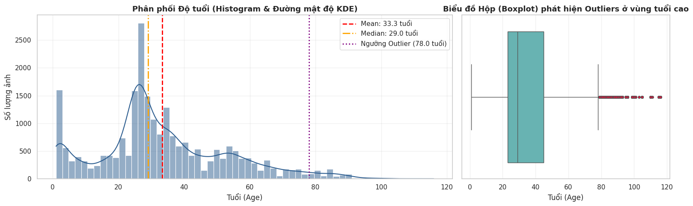
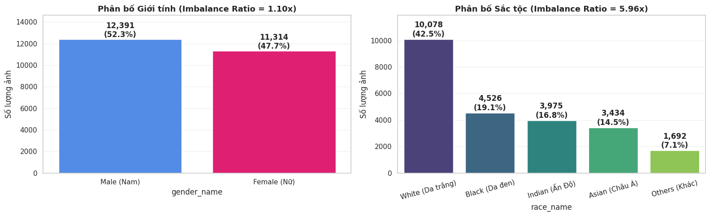
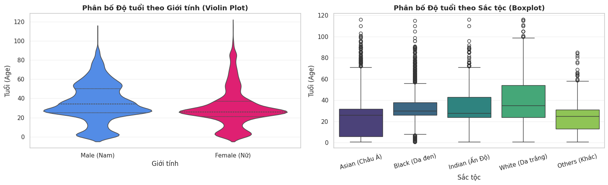
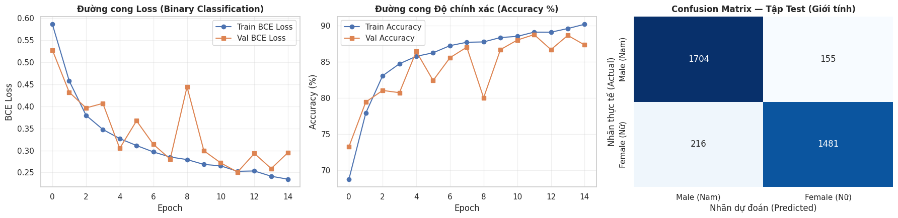
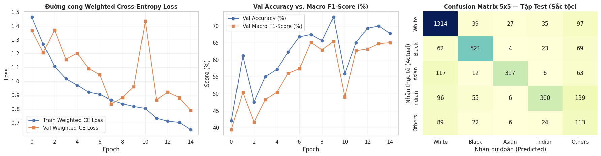
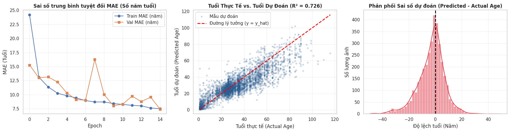

# Technical Report: Facial Attribute Classification and Age Regression on UTKFace

## 1. Introduction

Facial attribute estimation from unconstrained images involves solving both discrete classification and continuous regression problems over the same visual input space $\mathcal{X} \in \mathbb{R}^{3 \times H \times W}$:
- **Binary Classification**: Gender prediction (`Male` vs. `Female`).
- **Multi-class Classification**: Ethnicity classification across 5 categories (`White`, `Black`, `Asian`, `Indian`, `Others`).
- **Regression**: Continuous age estimation (`1–116` years).

This report documents the exploratory data analysis (`UTKFace_1.ipynb`), architectural design choices, training dynamics, and test set evaluation (`UTKFace_2.ipynb`) comparing three task-specific custom CNNs against a unified multi-task `ResNet-18` network.

---

## 2. Dataset Exploration & Preprocessing

### 2.1. Deduplication and Label Parsing

The `jangedoo/utkface-new` dataset distributes aligned facial chips across three subdirectories (`UTKFace/`, `utkface_aligned_cropped/UTKFace/`, and `crop_part1/`) with overlapping files. Indexing is restricted to `UTKFace/` (`23,708` files) to ensure disjoint train, validation, and test splits.

Ground-truth labels are parsed from the filename prefix `[age]_[gender]_[race]_[timestamp].jpg`. Three files lacked the `race` field (`61_1_20170109142408075.jpg.chip.jpg`, `61_1_20170109150557335.jpg.chip.jpg`, and `39_1_20170116174525125.jpg.chip.jpg`) and were removed, resulting in **$N = 23,705$ valid samples**.

### 2.2. Age Target Analysis

Descriptive statistics for `age` across all `23,705` images:
- **Range**: $1 \le y \le 116$ years
- **Mean and Standard Deviation**: $\mu = 33.30$, $\sigma = 19.89$ years
- **Quartiles**: $Q_1 = 23.0$, $Q_2 = 29.0$, $Q_3 = 45.0$ ($\text{IQR} = 22.0$ years)
- **Skewness**: $0.622$ (right-skewed with a dense young-adult peak between `20–35` years and a secondary infant peak at `1–2` years)
- **Outliers**: Using Tukey's fence ($Q_3 + 1.5 \times \text{IQR} = 78.0$ years), **`696` images (`2.94%`)** fall into the `79–116` age range.



### 2.3. Class Balance Analysis (`gender` and `race`)

The Imbalance Ratio (`IR = max(N_c) / min(N_c)`) quantifies label skewness:

1. **Gender (`IR = 1.10x`)**:
   - `Male (0)`: `12,391` (`52.27%`)
   - `Female (1)`: `11,314` (`47.73%`)

2. **Race (`IR = 5.96x`)**:
   - `White (0)`: `10,078` (`42.51%`)
   - `Black (1)`: `4,526` (`19.09%`)
   - `Indian (3)`: `3,975` (`16.77%`)
   - `Asian (2)`: `3,434` (`14.49%`)
   - `Others (4)`: `1,692` (`7.14%`)

To prevent the majority `White` class from dominating gradient updates, inverse-frequency class weights `w_c = N_total / (C * N_c)` are computed:

```text
w_race = [0.470, 1.048, 1.381, 1.193, 2.802]
```



### 2.4. Cross-Variable Distributions and Data Splitting

Cross-tabulating `age` against `gender` and `race` reveals demographic age shifts:
- **By Gender**: `Male` mean age is `35.70` (median `34.0`) vs. `Female` mean age `30.68` (median `26.0`).
- **By Race**: `White` has the highest mean age (`37.98`, median `35.0`), followed by `Black` (`33.86`, median `30.0`), `Indian` (`31.53`, median `28.0`), `Asian` (`25.87`, median `26.0`), and `Others` (`23.17`, median `25.0`).

To preserve joint demographic proportions, the dataset is split into **70% Train (`16,593`), 15% Validation (`3,556`), and 15% Test (`3,556`)** stratified on the 10-class `gender_race` combination.



### 2.5. Pixel Statistics

All sampled images are `200×200` RGB face chips with channel statistics:
- **Channel Mean (`UTK_MEAN`)**: `[0.5926, 0.4526, 0.3864]`
- **Channel Std (`UTK_STD`)**: `[0.2573, 0.2288, 0.2246]`

The elevated red channel mean (`0.5926`) reflects skin-tone dominance in tightly cropped facial images.

---

## 3. Model Architecture and Loss Formulation

### 3.1. Custom CNN Architecture (`UTKFaceBackbone`)

Input images are resized to `128×128` and normalized with `UTK_MEAN` and `UTK_STD`. Training augmentations include `RandomHorizontalFlip(p=0.5)`, `RandomRotation(10°)`, and `ColorJitter(brightness=0.15, contrast=0.15, saturation=0.15)`.

The custom feature extractor consists of 4 sequential convolutional blocks (`ConvBlock`):

```text
Conv2d(3x3, padding=1, bias=False) -> BatchNorm2d -> LeakyReLU(0.01) -> MaxPool2d(2x2)
```

- **Spatial Progression**: `3×128×128 → 32×64×64 → 64×32×32 → 128×16×16 → 256×8×8`.
- **Feature Head**: `AdaptiveAvgPool2d((1, 1))` collapses the `256×8×8` tensor into a `256`-d vector, followed by `Linear(256 → 128) → BatchNorm1d(128) → LeakyReLU(0.01) → Dropout(0.3)`. Each standalone custom CNN contains **`422,049` trainable parameters** (`422,565` for the 5-class race model).
- **Initialization**: Convolutional and linear weights use Kaiming He Normal initialization (`kaiming_normal_` with `a = 0.01`).

### 3.2. Task Heads and Loss Functions

#### 1. Binary Gender Classification (`BinaryGenderCNN`)
- **Output**: Single logit $z \in \mathbb{R}$, probability $\hat{p} = \sigma(z)$.
- **Loss**: Binary Cross-Entropy with Logits (`nn.BCEWithLogitsLoss()`):

$$
L_{\text{gender}} = -\left[y \ln \sigma(z) + (1 - y)\ln(1 - \sigma(z))\right]
$$

#### 2. Multi-class Race Classification (`MultiClassRaceCNN`)
- **Output**: 5 logits $z \in \mathbb{R}^5$, probabilities $\hat{p}_c = \text{Softmax}(z)_c$.
- **Loss**: Weighted Cross-Entropy (`nn.CrossEntropyLoss(weight=class_weights)`):

$$
L_{\text{race}} = -w_y \ln \frac{\exp(z_y)}{\sum_{j=0}^{4} \exp(z_j)}
$$

#### 3. Age Regression (`AgeRegressionCNN`)
- **Output**: Unbounded scalar $\hat{y} \in \mathbb{R}$ (Identity activation).
- **Loss**: Huber / Smooth L1 Loss (`nn.SmoothL1Loss(beta=5.0)`):

$$
L_{\text{age}}(y, \hat{y}) = \frac{1}{2\beta}(y - \hat{y})^2 \quad \text{for } |y - \hat{y}| < \beta
$$

$$
L_{\text{age}}(y, \hat{y}) = |y - \hat{y}| - \frac{1}{2}\beta \quad \text{for } |y - \hat{y}| \ge \beta
$$

Errors within `5` years are penalized quadratically for smooth convergence near the optimum, whereas errors exceeding `5` years (such as those on elderly outliers) incur a linear penalty with bounded gradient `±1`.

#### 4. Multi-Task Transfer Learning (`MultiTaskFaceResNet`)
- **Backbone**: ImageNet-pretrained `ResNet-18` (`512`-d feature output, `11,374,791` total parameters) connected to three parallel two-layer MLP heads (`gender_head`, `race_head`, `age_head`).
- **Joint Loss**: Age targets are scaled to `y / 100.0` in `[0.01, 1.16]` with `beta = 0.05`, and optimized via:

$$
L_{\text{joint}} = L_{\text{gender}} + L_{\text{race}} + 10.0 \cdot L_{\text{age}}
$$

---

## 4. Experimental Evaluation

### 4.1. Binary Gender Classification (`BinaryGenderCNN`)

Trained for 15 epochs with `AdamW(lr=1e-3, weight_decay=1e-4)`, `BinaryGenderCNN` reached its lowest validation loss at **Epoch 12** (`Val Loss: 0.2510`, `Val Acc: 88.75%`).

- **Test Accuracy**: **`89.57%`** (`3,185 / 3,556` correct)
- **Test Macro F1**: **`89.53%`**
- **Class Breakdown**:
  - `Male` (`1,859` samples): Precision `0.8875`, Recall `0.9166`, F1 `0.9018` (`1,704` true positives, `155` false negatives)
  - `Female` (`1,697` samples): Precision `0.9053`, Recall `0.8727`, F1 `0.8887` (`1,481` true positives, `216` false negatives)



### 4.2. Multi-class Race Classification (`MultiClassRaceCNN`)

`MultiClassRaceCNN` peaked at **Epoch 10** (`Val Acc: 72.55%`, `Val Macro F1: 65.41%`).

- **Test Accuracy**: **`72.13%`**
- **Test Macro F1**: **`65.01%`** (Weighted F1: **`72.92%`**)
- **Confusion Matrix & Class Trade-offs**:
  - `White`, `Black`, and `Asian` achieve strong F1 scores (`0.8238`, `0.7846`, and `0.7246`, respectively), with `Asian` recording the highest precision (`0.8806`).
  - The high weight assigned to `Others` ($w_4 = 2.802$) successfully prevents mode collapse on the minority class, yielding a **`44.49%` recall** (`113 / 254` test samples). However, because `Others` aggregates diverse ethnicities (Hispanic, Latino, Middle Eastern, multiracial), `139` `Indian` and `97` `White` test images are predicted as `Others`, reducing its precision to `23.49%`.



### 4.3. Age Regression (`AgeRegressionCNN`)

`AgeRegressionCNN` converged steadily over 15 epochs, reducing validation MAE from `15.26` years (Epoch 1) to **`7.42` years (Epoch 15)** with zero overfitting gap (`Train Huber Loss: 5.4462` vs. `Val Huber Loss: 5.3980`).

- **Test MAE**: **`7.53` years**
- **Test RMSE**: **`10.46` years**
- **Test $R^2$**: **`0.7261`**

The residual histogram ($e = \hat{y} - y$) is symmetric and centered at zero. Predictions track the diagonal closely between ages `1` and `70`, with mild underestimation above age `80` where training samples are sparse (`2.94%` of data).



### 4.4. Multi-Task Transfer Learning (`MultiTaskFaceResNet`)

Fine-tuning the pretrained `ResNet-18` multi-task architecture for 8 epochs (best checkpoint at **Epoch 5**, `Val Joint Loss: 1.1765`) outperformed all three standalone custom CNNs across every metric:

| Metric | Custom CNN (Standalone) | Multi-Task ResNet-18 | Absolute Delta |
| :--- | :---: | :---: | :---: |
| **Gender Test Accuracy (%)** | `89.57` | **`92.15`** | `+2.58%` |
| **Gender Macro F1 (%)** | `89.53` | **`92.15`** | `+2.62%` |
| **Race Test Accuracy (%)** | `72.13` | **`78.26`** | `+6.13%` |
| **Race Macro F1 (%)** | `65.01` | **`73.52`** | `+8.51%` |
| **Age Test MAE (years)** | `7.53` | **`5.49`** | `-2.04` years (`-27.1%`) |
| **Age Test RMSE (years)** | `10.46` | **`7.67`** | `-2.79` years (`-26.7%`) |
| **Age Test $R^2$** | `0.7261` | **`0.8531`** | `+0.1270` |

Residual connections and ImageNet pretraining enable finer texture extraction (wrinkles, skin tone gradients, facial contours), while joint supervision regularizes the shared `512`-d representation across demographic tasks.

---

## 5. Limitations and Future Work

1. **Class Weight Smoothing for `Race`**: Using dampened weights `w_c = (N_total / (C * N_c))^alpha` with `alpha` in `[0.5, 0.7]` or Focal Loss can reduce false-positive predictions into the `Others` category while preserving minority recall.
2. **Face Detection Preprocessing for Wild Images**: UTKFace consists of pre-aligned face crops. Adding an automated face detector (e.g., MTCNN or RetinaFace) to crop faces before resizing to `128×128` eliminates scale mismatch when evaluating uncropped portrait photographs.
3. **Label Distribution Learning for Age Estimation**: Modeling age as a soft Gaussian distribution over adjacent ages (DEX / Coral / LDL) can further reduce MAE below `5.0` years.
